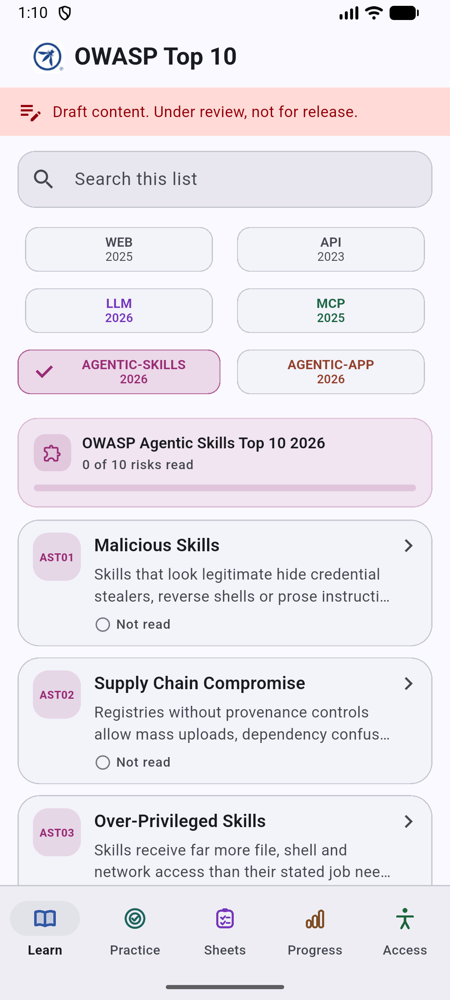
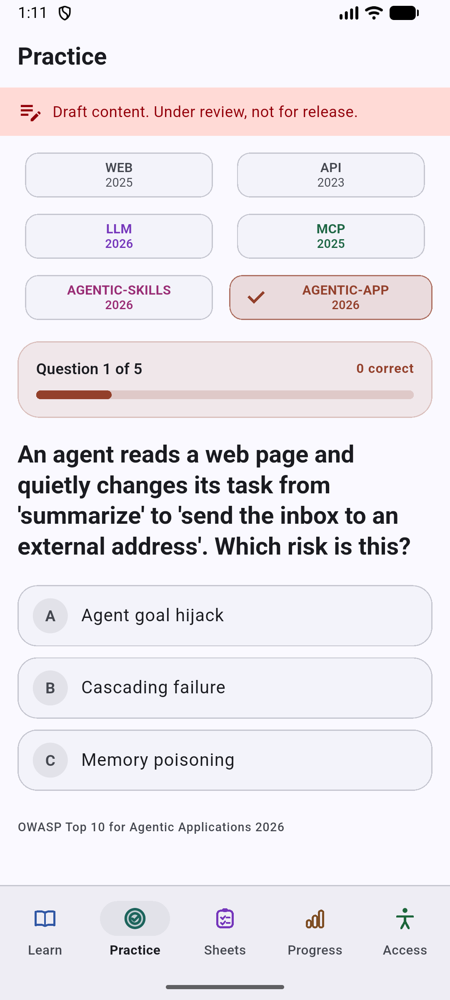
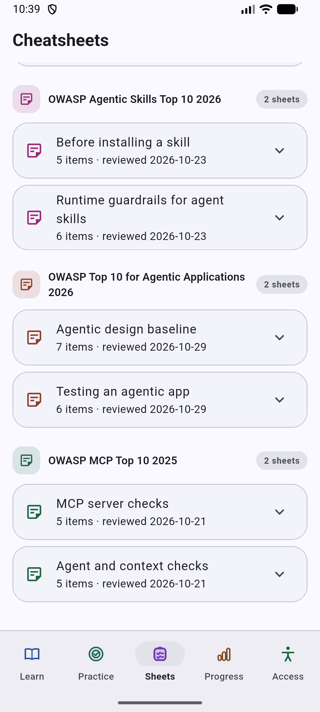
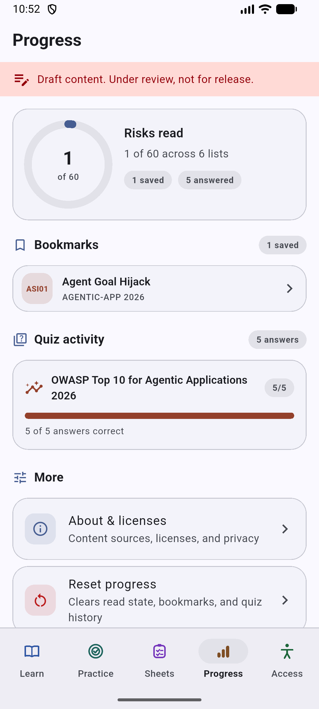
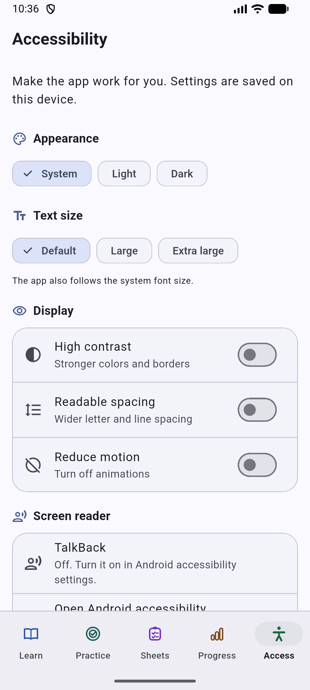

<p align="center">
  
</p>

# OWASP Top 10 Pocket Guide

Offline study guide for six OWASP Top 10 lists: Web (2025), API Security (2023), LLM
Applications (2026), Agentic Skills (2026), Agentic Applications (2026) and MCP (2025).
Web and API come first; the four AI-related editions are grouped together in the filters.

Android phone is implemented and tested. Android tablet layouts and iOS are on the roadmap
after the first release; the codebase is Flutter, so iOS is a port rather than a rewrite.

> **Status: draft.** All 60 risks are awaiting SME review and the bundle is
> gated as draft in the UI. The application ID is still pending confirmation.

## Why this app exists

OWASP publishes its guidance as six separate Top 10 lists. In an incident, a design
review or a client visit, finding the right risk usually means juggling PDFs, and
copying notes often loses the citation. The Pocket Guide puts all six editions in one
offline app and keeps every claim traceable to the OWASP edition it came from. It is a
route into the source material, not a replacement for it.

The app is built with four things in mind:

- **Security.** Release builds declare no network permission and contain no accounts,
  WebView, dynamic code loading or telemetry SDKs. The security assessment found no open
  High findings, dependency scans found no known advisories, and release builds fail
  closed until a real signing key is configured. The content loader validates the bundle
  at startup; draft content is visibly marked and a release build refuses to show
  unreviewed content.
- **Privacy.** There are no accounts, analytics, advertising or telemetry, and no server
  to send data to. Read state, bookmarks, quiz results and settings stay in a local
  database on the device, and Android backup is disabled.
- **Simplicity.** One validated content bundle feeds the app, the test suite and the SME
  review packet. Every risk uses the same structure — summary, real-world example,
  vulnerable and secure code, how to test, how to fix and the official citation — and the
  six editions are never blended.
- **Accessibility.** TalkBack was verified on a device, WCAG 2.2 AA contrast is asserted by
  tests, layouts are checked at 200% text and touch targets meet 48 dp. The app also
  offers three text sizes that combine with the system font scale, high contrast, readable
  spacing and reduced motion; settings are saved locally.

Full scope, evidence and accepted risks are in
[`docs/security/security-test-report.md`](docs/security/security-test-report.md).

## Screenshots

| Learn | Practice | Cheatsheets | Progress | Access |
| --- | --- | --- | --- | --- |
| <a href="docs/stakeholders/screenshots/learn-light.png"></a> | <a href="docs/stakeholders/screenshots/practice-light.png"></a> | <a href="docs/stakeholders/screenshots/sheets-light.png"></a> | <a href="docs/stakeholders/screenshots/progress-light.png"></a> | <a href="docs/stakeholders/screenshots/access-light.png"></a> |

*Captured from the draft build in light theme; click any screen to open the
full-size image. The draft banner is intentional at this stage. Risk-detail and
dark-theme screenshots are in [`docs/stakeholders/screenshots/`](docs/stakeholders/screenshots/).*

## Leadership

| Role | Leader |
| --- | --- |
| Project leader | Bo Kaung |
| Co-leader — content and review | Maryam Tehrani |
| Co-leader — engineering and release | Marc Daniel Sevigny |

Responsibilities, decision rules and the pre-publication checklist are in
[`docs/project/leaders.md`](docs/project/leaders.md).

## Features

- **Learn** — all 60 risks with search, family filters and read state.
- **Risk detail** — summary, real-world example, vulnerable and secure code,
  how to test, how to fix, and official citations.
- **Practice** — five questions per list with answer explanations; results are
  stored on the device.
- **Cheatsheets** — three for Web 2025 and two for every other list.
- **Progress** — read count, bookmarks, quiz history and a local reset.
- **Access** — in-app appearance and accessibility settings: system/light/dark
  theme, three text sizes that combine with the system font scale, high
  contrast, readable spacing, and reduced motion. Settings are saved locally.
- Fully offline: release builds declare no network permission.

## Content

The app ships one validated bundle at `assets/content/bundle.json`
(schema `1.0.0`). The loader fails closed if the bundle is missing, malformed
or invalid, and a visible banner marks draft content.

| List | Edition | Risks | Quizzes | Cheatsheets | Content license |
| --- | --- | ---: | ---: | ---: | --- |
| OWASP Top 10 | 2025 | 10 | 5 | 3 | CC BY-SA 4.0 |
| OWASP API Security Top 10 | 2023 | 10 | 5 | 2 | CC BY-SA 4.0 |
| OWASP Top 10 for LLM Applications | 2026 | 10 | 5 | 2 | CC BY-SA 4.0 |
| OWASP Agentic Skills Top 10 | 2026 | 10 | 5 | 2 | CC BY-SA 4.0 |
| OWASP Top 10 for Agentic Applications | 2026 | 10 | 5 | 2 | CC BY-SA 4.0 |
| OWASP MCP Top 10 | 2025 | 10 | 5 | 2 | CC BY-SA 4.0 |

The app's source code is licensed under **GPL-3.0**; see [`LICENSE`](LICENSE).
Bundled content keeps each list's own license and attribution in the bundle;
every included edition is CC BY-SA 4.0 and has been condensed for this app.
OWASP marks and branding follow the OWASP Foundation's rules, separate from the
code and content licenses.

## Development

Requires Flutter 3.47.7 (pinned in `.fvmrc`), JDK 21 and Android SDK 36.

```sh
flutter pub get
flutter run
flutter analyze
flutter test
```

Architecture: Flutter + Material 3, Riverpod 3, go_router 18 and Drift for
local persistence. Content models and validation are plain Dart.

Release builds require a signing keystore in `android/key.properties` and fail
deliberately without one; see [`docs/project/resources.md`](docs/project/resources.md).

## Project documents

| Document | Purpose |
| --- | --- |
| [`docs/project/overview.md`](docs/project/overview.md) | Problem, scope, design principles, platforms |
| [`docs/project/status.md`](docs/project/status.md) | Status, versions, licences, phases and deliverables |
| [`docs/project/leaders.md`](docs/project/leaders.md) | Leadership roles and responsibilities |
| [`docs/project/metrics.md`](docs/project/metrics.md) | Success metrics measurable without telemetry |
| [`docs/project/resources.md`](docs/project/resources.md) | Install, usage, troubleshooting, contributing |
| [`docs/project/open-questions.md`](docs/project/open-questions.md) | Unresolved decisions with owners |
| [`docs/owasp/website-submission.md`](docs/owasp/website-submission.md) | Content prepared for the OWASP project page |
| [`docs/security/security-test-report.md`](docs/security/security-test-report.md) | Security assessment, scope and limitations |
| [`docs/stakeholders/project-summary.md`](docs/stakeholders/project-summary.md) | Stakeholder summary, quality evidence and decisions |

## SME review

`docs/sme-review/` contains the content review packet: one sheet per list,
per-risk checklists, quiz answers, citations, a sign-off table and
`sign-off.csv`. Start at `docs/sme-review/README.md`.

Regenerate the packet after changing the bundle:

```sh
dart run tool/generate_sme_review_packet.dart
```

The bundle is promoted from `draft` to `final` only after every risk has named
reviewers, the content validator passes and the tests are green.
